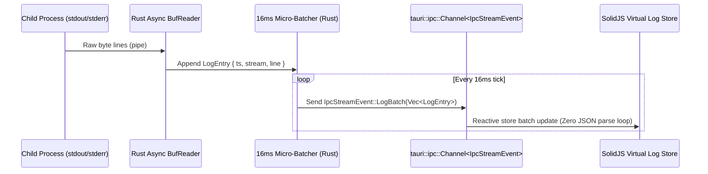
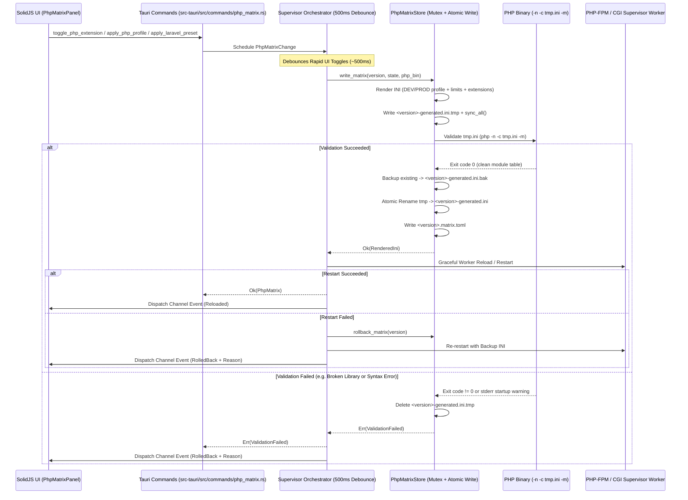

# Rakitray System Architecture

This document defines the strict architectural boundaries, inter-process communication (IPC) protocols, OS process supervision guarantees, and runtime module manifest specifications of **Rakitray**.

All contributors and AI coding agents must adhere to these boundaries without exception.

---

## 1. High-Level Architectural Overview

Rakitray is engineered as a **systems-first native development environment orchestrator** using **Rust (Tauri v2 + Tokio)** for all OS-level orchestration and **SolidJS (TypeScript)** for a low-memory, zero-Virtual-DOM reactive user interface.

Both the **`rakit` CLI** and the **Tauri v2 Desktop GUI** are parallel presentation clients powered by a unified Rust systems engine: `rakitray-core`.

```mermaid
flowchart TB
    subgraph Clients["Presentation Clients"]
        CLI["'rakit' Terminal CLI\n(Headless, CI/CD, Scriptable)"]
        GUI["Tauri v2 GUI\n(SolidJS Reactive Views, Zero-RAM Tray)"]
    end

    subgraph Core["src-tauri/ — rakitray-core (Rust Systems Core)"]
        Commands["Tauri IPC Commands\n(src-tauri/src/commands/)"]
        Supervisor["Dynamic Rack Supervisor\n(Win32 Job Objects / Unix PGID / prctl)"]
        Drivers["ServiceDriver Registry\n(Nginx, Caddy, PHP-FPM, MariaDB, Postgres, Redis, Generic)"]
        Downloader["Multi-Threaded Downloader\n& SHA-256 Verifier"]
        Extractor["Streaming Archive Extractor\n(.pdb & test-suite filter pipeline)"]
        ConfigEngine["Dynamic Config Generator\n& .rakitray.toml Workspace Resolver"]
        PortDoctor["Native Socket & PID Scanner\n(Smart Port Doctor)"]
        TrayMgr["Zero-RAM Tray Lifecycle Manager\n(WebView Destroy / Recreate)"]
    end

    subgraph Runtimes["Operating System & Child Runtimes"]
        Processes["Isolated Runtime Processes\n(Nginx, PHP-CGI/FPM, MariaDB, Redis, etc.)"]
        FS["Portable Runtime Hierarchy\n(bin/, config/, data/, logs/, tmp/, www/)"]
    end

    CLI --> Core
    GUI ==>|invoke() + Channel| Commands
    Commands --> Supervisor
    Supervisor --> Drivers
    Drivers --> Processes
    Supervisor --> Processes
    Downloader --> Extractor
    Extractor --> FS
    ConfigEngine --> FS
    PortDoctor --> Processes
```

---

## 2. Strict Architectural Boundaries

To guarantee sub-second startup, minimal memory footprint, and deterministic process control, Rakitray enforces a hard separation of concerns between `src/` and `src-tauri/`.

### 2.1 Frontend Layer (`src/` — SolidJS + TypeScript)
**Allowed Responsibilities:**
- Rendering zero-overhead declarative UI components using SolidJS fine-grained reactivity (`createSignal`, `createStore`, `createMemo`).
- Maintaining bounded, in-memory UI state projections (e.g., virtualized log ring buffer of the latest `N` lines, service status badges, download progress bars).
- Invoking typed Tauri commands (`invoke()`) and subscribing to `Channel<T>` streams.
- Keyboard shortcuts, theme switching, and accessibility navigation.

#### 2.1.1 Atomic Design Architecture
The frontend is organized using a strict Atomic Design methodology under `src/components/`:
- **Atoms (`src/components/atoms/`)**: Pure, reusable presentation elements: `StatusLed` (status dot with emerald/amber/rose glow), `MetricBadge` (monospace telemetry tags), `ActionButton` (sysadmin action triggers), and `VersionBadge` (engine version and profile tags).
- **Molecules (`src/components/molecules/`)**: Functional UI strips composed of atoms: `MasterControlStrip` (global start/stop/scan controls + aggregated stack CPU & RAM), `ServiceRow` (dense matrix table rows), and `LogFilterBar` (stream filter pills and clear button).
- **Organisms (`src/components/organisms/`)**: Full functional workstation panels: `SidebarNav` (FlyEnv left navigation), `ServiceRackMatrix` (service rows table), `SiteRoutingPanel` (Laravel virtual host & upstream mapper), `RuntimeDiscoveryGrid` (portable binary explorer), and `DockedLogTerminal` (fixed bottom live log terminal).
- **Templates (`src/components/templates/`)**: Full-viewport layout shells: `WorkstationShell`.
- **Centralized Store (`src/store/supervisorStore.ts`)**: Fine-grained reactive store using `createStore` & `produce`, maintaining a 500-line bounded ring buffer to guarantee zero memory leaks during 60Hz IPC log streaming.

**Strictly Forbidden in `src/`:**
- **NO** direct filesystem reads/writes (`@tauri-apps/plugin-fs` is NOT used in frontend code).
- **NO** spawning or managing child processes from JavaScript (`@tauri-apps/plugin-shell` is NOT used in frontend code).
- **NO** parsing or templating `.rakitray.toml`, `nginx.conf`, `php.ini`, or `my.cnf` in TypeScript.
- **NO** polling loops (`setInterval` calling `invoke("get_status")`) for process health or logs—all telemetry is pushed from Rust over `tauri::ipc::Channel`.
- **NO** heavy third-party UI component libraries, CSS-in-JS runtimes, or state management wrappers (Redux, MobX, React compatibility layers).

### 2.2 Systems Core Layer (`src-tauri/` — Rust)
**Responsibilities:**
- **Dynamic Rack Supervisor (`supervisor/`):** Manages an arbitrary number of concurrent service instances using the extensible `ServiceDriver` trait.
- **Binary Registry & Downloader (`registry/`, `downloader/`):** Fetching module manifests, parallel HTTP range/stream downloading, cryptographic SHA-256 verification, and atomic directory swaps.
- **Lean Archive Extractor (`extractor/`):** Decompressing archives while applying glob-based exclusion filters before bytes hit disk.
- **Dynamic Config Engine (`config/`):** Parsing `.rakitray.toml` manifests and rendering deterministic configs (`nginx.conf`, `Caddyfile`, `php.ini`, `my.cnf`).
- **Smart Port Doctor (`net/`):** Inspecting TCP/UDP socket tables, mapping occupied ports to owning PIDs, and resolving conflicts.
- **Zero-RAM Tray Controller (`tray/`):** Intercepting window close to destroy the WebView window (dropping UI RAM to 0 MB) while Tokio supervisor continues in tray.

### 2.3 Dynamic Rack & `ServiceDriver` Trait

Rakitray is not locked to a static 3-service stack. The supervisor delegates process lifecycle, argument compilation, configuration generation, and health checks to implementations of the `ServiceDriver` trait:

```rust
#[async_trait]
pub trait ServiceDriver: Send + Sync {
    /// Service category identifier (e.g. web_server, runtime, database, cache, tool)
    fn category(&self) -> ServiceCategory;

    /// Engine identifier (e.g. "nginx", "caddy", "php-fpm", "mariadb", "postgresql", "redis", "generic")
    fn engine(&self) -> &'static str;

    /// Prepare configuration files before starting
    async fn prepare_config(&self, instance: &ServiceInstance, ctx: &RuntimeContext) -> Result<PathBuf, RakitrayError>;

    /// Compile binary launch command and arguments
    fn compile_command(&self, instance: &ServiceInstance, ctx: &RuntimeContext) -> Result<Command, RakitrayError>;

    /// Run post-start healthcheck (TCP socket, PID check, or ping)
    async fn health_check(&self, instance: &ServiceInstance) -> Result<bool, RakitrayError>;
}
```

**Supported Service Drivers:**
1. **`nginx`** (Primary Web Server): Dynamic upstream pooling to multi-version PHP-FPM / CGI sockets.
2. **`caddy`** (Alternative Web Server): Automatic local HTTPS reverse proxy.
3. **`php-fpm` / `php-cgi`** (Language Runtime): Multi-version isolated worker pools (PHP 7.4, 8.0, 8.1, 8.2, 8.3, 8.4) with dynamic extension scanning.
4. **`mariadb`** (Relational Database): Autonomous data directory initialization and socket binding.
5. **`postgresql`** (Relational Database): Multi-cluster cluster initialization and port routing.
6. **`redis`** (In-Memory Cache): Transient or persistent key-value store.
7. **`generic`** (Custom Binaries): Supervised execution for ad-hoc developer tools (e.g., Mailpit, Meilisearch, Bun/Node dev servers).

---

## 3. High-Frequency IPC Design (`tauri::ipc::Channel`)

### Why Legacy Event Bus Serialization Fails
Standard Tauri/Electron applications dispatch logs via `app.emit("log-line", payload)`. This serializes messages through JSON and dispatches them across all WebView listeners. Under heavy logs (database migrations, busy web access logs), the UI freezes.

### Rakitray's Raw IPC Channel Architecture
Rakitray uses **Tauri v2 `tauri::ipc::Channel`** with **16ms micro-batching (60Hz)**:



---

## 4. OS Process Supervision Guarantees (Zero Zombie Guarantee)

Rakitray guarantees that no background child process is ever orphaned when the application exits, crashes, or is force-killed.

### 4.1 Windows: Win32 Job Objects
Every child process is assigned to an OS Job Object with `JOB_OBJECT_LIMIT_KILL_ON_JOB_CLOSE`:
```rust
let job = Job::create()?;
let mut info = job.query_extended_limit_info()?;
info.BasicLimitInformation.LimitFlags |= JOB_OBJECT_LIMIT_KILL_ON_JOB_CLOSE;
job.set_extended_limit_info(&mut info)?;
job.assign_process(child_handle)?;
```

### 4.2 Linux & macOS: Process Groups & `prctl`
Every child process is placed in a new process group (`setpgid(0, 0)`). On Linux, `prctl(PR_SET_PDEATHSIG, SIGTERM)` ensures child processes terminate if the parent process dies:
```rust
unsafe {
    cmd.pre_exec(|| {
        libc::setpgid(0, 0);
        #[cfg(target_os = "linux")]
        libc::prctl(libc::PR_SET_PDEATHSIG, libc::SIGTERM);
        Ok(())
    });
}
```
Stopping signals the negative PGID (`-pgid`) with `SIGTERM`, escalating to `SIGKILL` after a 5-second graceful timeout.

---

## 5. Lean Archive Extraction Pipeline

To keep disk usage minimal, the extractor filters bloat files on the fly during archive decompression:
- **Debug Symbols & Import Libraries:** `**/*.pdb`, `**/*.lib`, `**/*.exp`
- **Embedded Test Suites & Benchmarks:** `mysql-test/**`, `sql-bench/**`, `test/**`
- **Redundant Documentation:** `**/man/**`, `**/doc/**`, `**/docs/**`

### Zip-Slip Defense
Every entry path is canonicalized and validated to ensure it cannot escape outside the target directory. Entries with `..` or absolute paths abort extraction immediately.

---

## 6. Portable Runtime Directory Hierarchy

All downloaded binaries, runtime configurations, databases, and logs live inside a self-contained, portable runtime root:

```text
runtime/
├── bin/                    # Discovered lean portable binaries
│   └── <category>/<engine>/<version>/
│       ├── web_server/nginx/1.26.2/
│       ├── runtime/php-cgi/8.3.12/
│       └── database/mariadb/11.4.3/
├── config/                 # Dynamically generated service configs (nginx.conf, php.ini, my.cnf)
├── data/                   # Persistent database and cache storage (mariadb/, redis/)
├── logs/                   # Rotating process output logs (*.log)
├── tmp/                    # PID files, Unix domain sockets, temporary pipes
└── www/                    # Default web root and local project sites
```

---

## 7. PHP INI & Extension Matrix Architecture (v0.2.0)

Rakitray v0.2.0 introduces a deterministic, atomic PHP configuration engine designed to eliminate manual `php.ini` editing and accidental syntax corruption.



### 7.1 Cross-Platform Extension Scanner (`discovery/php_ext.rs`)
- Scans `ext/` (Windows `.dll`, Linux `.so`).
- Invokes `<php-bin> -n -m` to reconcile built-in modules compiled into the binary.
- Categorizes extensions into 5 fixed tiers: `laravelCore`, `databaseCache`, `performanceDebug`, `mediaFormat`, and `other`.
- Applies dependency ordering (e.g. `mbstring` must precede `exif`, `pdo` must precede `pdo_mysql`).

### 7.2 Atomic Write & User INI Preservation (`drivers/php_matrix_store.rs`)
- **Per-Version Mutex:** Serializes concurrent writes per PHP version.
- **Generated INI Separation:** Auto-rendered directives live exclusively in `<version>-generated.ini`.
- **User Customizations Preserved:** Custom directives live in `<version>-user.ini`, read automatically via `PHP_INI_SCAN_DIR`.
- **Pre-flight Validation:** Before activating any change, Rakitray launches `<php-bin> -n -c <tmp.ini> -m`. If validation fails, `<tmp.ini>` is destroyed and the active INI is never touched.
- **Automatic Rollback:** If worker restart fails after activation, the supervisor automatically restores `<version>-generated.ini.bak` and issues a second reload.

---

## 8. Manual Test Checklist (v0.2.0)

### 8.1 Windows Environment (`ext/*.dll`)
1. **Dynamic DLL Discovery:** Place `php_redis.dll` and `php_xdebug.dll` in `runtime/bin/runtime/php/<version>/ext/`. Open Rakitray -> navigate to "PHP Matrix" -> verify extensions appear under "Database & Cache" and "Performance & Debug".
2. **Interactive Toggling:** Toggle `redis` ON -> verify generated INI has `extension=redis` -> verify service reloads without dropped requests.
3. **Dependency Protection:** Attempt to enable `exif` without `mbstring` -> verify validation error or warning prevents orphan activation.
4. **1-Click Laravel Preset:** Click "⚡ 1-Click Laravel Preset" -> verify all Laravel 12/13 required extensions (`pdo_mysql`, `curl`, `mbstring`, `fileinfo`, `zip`, `bcmath`) activate simultaneously.
5. **Profile Clone:** Select PHP 8.3 -> Click "⎘ Clone to…" -> select PHP 8.2 -> review diff modal -> confirm clone -> verify PHP 8.2 receives identical profile and limits with isolated `extension_dir`.

### 8.2 Linux & macOS Environment (`ext/*.so` / Static Builds)
1. **BuiltIn Reconciliation:** Launch Rakitray with a static PHP CLI build -> verify built-in modules (`ctype`, `fileinfo`, `hash`, `pcre`, `session`, `tokenizer`, `xml`) are detected, marked `built-in`, and locked against disabling with informative tooltips.
2. **Shared Module Toggle:** Install shared `.so` modules -> verify toggling emits `extension=<name>.so` and reloads PHP-FPM pool cleanly.
3. **Rollback Verification:** Introduce a deliberately corrupt extension line -> trigger apply -> verify Rakitray intercepts validation error, keeps backup INI, and displays error toast.

---

## 9. Critical Area Test Coverage Report

| Subsystem / Area | Test File | Verified Invariants |
| :--- | :--- | :--- |
| **INI Template Engine** | `src-tauri/src/drivers/php_fpm.rs` | DEV vs PROD profile rendering, `display_errors` toggling, `xdebug.mode=off` in PROD, topological dependency ordering, newline/null-byte injection rejection. |
| **Extension Scanner** | `src-tauri/src/discovery/php_ext.rs` | Windows `.dll` parsing, Linux `.so` parsing, `php -n -m` built-in detection, non-panicking missing directory handling, INI & TOML state parsing. |
| **Atomic Store & Rollback** | `src-tauri/src/drivers/php_matrix_store.rs` | Mutex serialization, atomic rename, `.bak` file creation, validation failure preservation of old INI, mid-write crash resilience, `user.ini` preservation. |
| **Supervisor Orchestrator** | `src-tauri/src/supervisor/php_matrix.rs` | 500ms debounce collapsing rapid clicks, worker restart sequence, automatic rollback to `.bak` on restart failure, `PhpMatrixEvent` channel dispatch. |
| **IPC Commands & Security** | `src-tauri/src/commands/php_matrix.rs` | Path traversal (`../`) rejection, newline injection rejection, unknown extension rejection, 3-tier Laravel preset, cross-version profile cloning. |
| **End-to-End Fake Runtime** | `src-tauri/tests/php_matrix_e2e.rs` | Full headless pipeline execution with stubbed `php` binary mimicking `php -m` and pre-flight `-n -c <tmp> -m` syntax validation. |

