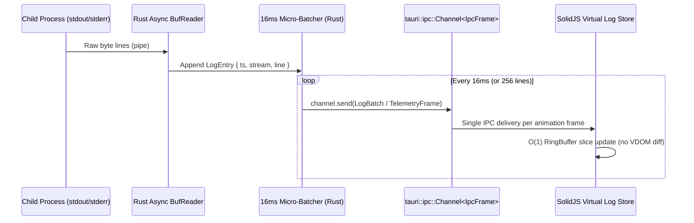

# Rakitray System Architecture

This document defines the strict architectural boundaries, inter-process communication (IPC) protocols, OS process supervision guarantees, and runtime module manifest specifications of **Rakitray**.

All contributors and AI coding agents must adhere to these boundaries without exception.

---

## 1. High-Level Architectural Overview

Rakitray is engineered as a **systems-first native desktop application** using **Rust (Tauri v2)** for all OS-level orchestration and **SolidJS (TypeScript)** for a low-memory, zero-Virtual-DOM reactive user interface.

```mermaid
flowchart TB
    subgraph Frontend["src/ — SolidJS Reactive UI Layer (Zero System Logic)"]
        Views["Virtualized Views\n(Dashboard, Log Stream, Port Doctor, Catalog)"]
        Stores["Fine-Grained Solid Stores & Signals\n(ServiceState, TelemetryRingBuffer)"]
        IPC_Bridge["Typed IPC Client Bridge\n(invoke + tauri::ipc::Channel)"]
    end

    subgraph Core["src-tauri/ — Rust Systems Core (Single Source of Truth)"]
        Commands["Tauri Command Handlers\n(src-tauri/src/commands/)"]
        Supervisor["Process Supervisor Engine\n(Win32 Job Objects / Unix PGID)"]
        Downloader["Multi-Threaded Downloader\n& SHA-256 Verifier"]
        Extractor["Streaming Archive Extractor\n(.pdb & test-suite filter pipeline)"]
        ConfigEngine["Dynamic Config Generator\n& .dev.toml Workspace Resolver"]
        PortDoctor["Native Socket & PID Scanner\n(Smart Port Doctor)"]
        TrayMgr["Zero-RAM Tray Lifecycle Manager\n(WebView Destroy / Recreate)"]
    end

    subgraph OS["Operating System & Child Runtimes"]
        Processes["Isolated Runtime Processes\n(PHP-CGI, Nginx, Caddy, MariaDB, Redis, Node, Bun)"]
        FS["Local Portable Runtime Store\n(bin/, data/, logs/, tmp/)"]
    end

    Views --> Stores
    Stores <--> IPC_Bridge
    IPC_Bridge ==>|Commands: invoke()| Commands
    Supervisor ==>|Raw Stream: tauri::ipc::Channel| IPC_Bridge
    Commands --> Supervisor
    Commands --> Downloader
    Commands --> ConfigEngine
    Commands --> PortDoctor
    Commands --> TrayMgr
    Downloader --> Extractor
    Extractor --> FS
    ConfigEngine --> FS
    Supervisor --> Processes
    PortDoctor --> Processes
```

---

## 2. Strict Architectural Boundaries (`src/` vs. `src-tauri/`)

To guarantee sub-second startup, minimal memory footprint, and deterministic process control, Rakitray enforces a hard separation of concerns between `src/` and `src-tauri/`.

### 2.1 Frontend Layer (`src/` — SolidJS + TypeScript)
**Allowed Responsibilities:**
- Rendering zero-overhead declarative UI components using SolidJS fine-grained reactivity (`createSignal`, `createStore`, `createMemo`).
- Maintaining bounded, in-memory UI state projections (e.g., virtualized log ring buffer of the latest `N` lines, service status badges, download progress bars).
- Invoking typed Tauri commands (`invoke()`) and subscribing to `Channel<T>` streams.
- Keyboard shortcuts, theme switching, and accessibility navigation.

**Strictly Forbidden in `src/`:**
- **NO** direct filesystem reads/writes (`@tauri-apps/plugin-fs` is NOT used in frontend code).
- **NO** spawning or managing child processes from JavaScript (`@tauri-apps/plugin-shell` is NOT used in frontend code).
- **NO** parsing or templating `.dev.toml`, `nginx.conf`, `php.ini`, or `my.cnf` in TypeScript.
- **NO** polling loops (`setInterval` calling `invoke("get_status")`) for process health or logs—all telemetry is pushed from Rust over `tauri::ipc::Channel`.
- **NO** heavy third-party UI component libraries, CSS-in-JS runtimes, or state management wrappers (Redux, MobX, React compatibility layers).

### 2.2 Systems Core Layer (`src-tauri/` — Rust)
**Responsibilities:**
- **Process Supervisor (`supervisor/`):** Spawning, health-checking, graceful stopping, and guaranteed termination of child service trees via OS-native primitives.
- **Binary Registry & Downloader (`registry/`, `downloader/`):** Fetching module manifests, parallel HTTP range/stream downloading, cryptographic SHA-256 verification, and atomic directory swaps.
- **Lean Archive Extractor (`extractor/`):** Decompressing `.zip`, `.tar.gz`, and `.tar.xz` archives while applying glob-based exclusion filters before bytes hit the disk.
- **Dynamic Config Engine (`config/`):** Parsing project `.dev.toml` manifests and rendering deterministic config files (`nginx.conf`, `Caddyfile`, `php.ini`, `my.ini`) with portable relative paths.
- **Smart Port Doctor (`net/`):** Inspecting local TCP/UDP socket tables, mapping occupied ports to owning PIDs and executable paths, and resolving conflicts.
- **Zero-RAM Tray Controller (`tray/`):** Intercepting window close events to destroy the WebView window (releasing 100% of WebView memory) while keeping the Rust Tokio runtime and system tray menu active, and reconstructing the WebView window on tray activation.

---

## 3. High-Frequency IPC Design (`tauri::ipc::Channel`)

### Why Legacy Event Bus Serialization Fails for Dev Launchers
In standard Tauri/Electron applications, emitting process logs or CPU/RAM metrics via `app.emit("log-line", payload)` serializes every message through JSON, dispatches it globally across all WebView listeners, and triggers `JSON.parse()` on the main UI thread. When a database migration or access log bursts at 10,000+ lines/sec, the UI freezes and memory spikes.

### Rakitray's Raw IPC Channel Architecture
Rakitray uses **Tauri v2 `tauri::ipc::Channel`** with **time-windowed micro-batching (16ms / 60Hz)** and compact binary/tuple frames:



1. **Dedicated Channels per Stream Class:**
   - `LogChannel`: Streams batched `stdout`/`stderr` chunks for the currently inspected service(s). When the user switches tabs or closes the window (Zero-RAM Tray mode), the Rust supervisor immediately pauses IPC emission while continuing to write to rotating disk logs (`logs/<service>.log`).
   - `TelemetryChannel`: Pushes compact binary/struct snapshots of active service PIDs, state transitions (`Stopped`, `Starting`, `Running`, `Degraded`, `Stopping`, `Crashed`), CPU%, RSS memory bytes, and active port bindings.
   - `DownloadChannel`: Streams byte-level download and extraction progress for active module installations.
2. **Backpressure & Zero-RAM Awareness:**
   - When the WebView is destroyed in Tray Mode, all active `Channel` handles are dropped cleanly; the Rust core skips serialization entirely, resulting in **0% CPU usage at idle**.

---

## 4. Anti-Zombie Process Supervision Architecture

Traditional launchers track only the top-level PID returned by `spawn()`. When a service like Nginx, PHP-CGI, or MariaDB forks worker processes—or when the launcher itself crashes—those child processes become orphaned "zombies" holding ports `80`, `443`, or `3306` hostage.

Rakitray eliminates zombie processes at the OS kernel level:

### 4.1 Windows: Win32 Job Objects
- On startup, Rakitray creates a managed Win32 Job Object (`CreateJobObjectW`) per service (and a master supervisor Job Object) configured with `JOB_OBJECT_EXTENDED_LIMIT_INFORMATION` and the flag:
  ```text
  JOB_OBJECT_LIMIT_KILL_ON_JOB_CLOSE
  ```
- Every spawned service process is immediately assigned to the Job Object (`AssignProcessToJobObject`).
- Any child or grandchild process spawned by that service automatically inherits membership in the Job Object.
- If the service is stopped—or if Rakitray itself is terminated via Task Manager (`TerminateProcess`)—the Windows kernel closes the Job Object handle and **atomically terminates every process in the tree**.

### 4.2 Linux & macOS: Unix Process Groups & Death Signals
- Every service is spawned inside its own dedicated Process Group via `CommandExt::process_group(0)` (`setpgid(0, 0)`).
- On Linux, `pre_exec` additionally configures `prctl(PR_SET_PDEATHSIG, SIGTERM)` so the kernel signals the child immediately if the parent supervisor thread dies unexpectedly.
- Graceful shutdown sends `SIGTERM` (or service-specific stop signals like `nginx -s quit`) to the entire negative PGID (`kill(-pgid, SIGTERM)`), waits up to a configurable deadline (default `3000ms`), and escalates to `kill(-pgid, SIGKILL)` to guarantee complete cleanup.

---

## 5. Lean Binary Extraction Pipeline

When downloading an archive (e.g., `mariadb-11.4.4-winx64.zip` or `php-8.3-nts-Win32-vs16-x64.zip`), Rakitray streams the archive entries through a **Filter Pipeline** before allocating files on disk:

```text
HTTP Stream -> SHA-256 Hasher -> Archive Entry Iterator -> Strip Glob Filter -> Path Traversal Guard -> Disk Writer
```

### Default Strip Rules (Configurable per Module)
- **Debug Symbols:** `**/*.pdb`, `**/*.dbg`, `**/*.dSYM/**`
- **Test Suites & Benchmarks:** `**/mysql-test/**`, `**/sql-bench/**`, `**/tests/**`, `**/test/**`
- **Static Libraries & C Headers (when not required at runtime):** `**/*.lib`, `**/include/**` (optional per module)
- **Redundant Docs/Manuals:** `**/man/**`, `**/doc/**`, `**/docs/**`

### Security Guardrails in Extractor
- **Zip Slip / Path Traversal Prevention:** Every archive entry path is normalized and verified to resolve strictly inside the target sandbox directory (`bin/<category>/<module>/<version>/`). Entries containing `..` segments, absolute paths, or symlink escapes outside the sandbox abort extraction immediately.

---

## 6. Module Manifest Specification

Downloadable runtimes in Rakitray's "Install-as-You-Need" catalog are defined declaratively using the **Rakitray Module Manifest Schema**.

```toml
# Example: modules/mariadb.toml
[module]
id = "mariadb"
name = "MariaDB Server"
category = "database" # "webserver" | "runtime" | "database" | "cache" | "tool"
description = "Community-developed, commercially supported fork of the MySQL relational database."
homepage = "https://mariadb.org/"
license = "GPL-2.0"
default_port = 3306

[extraction]
strip_top_level_dir = true
exclude_globs = [
    "**/*.pdb",
    "**/*.lib",
    "mysql-test/**",
    "sql-bench/**",
    "include/**",
    "man/**",
]

[lifecycle]
binary_rel_path.windows = "bin/mariadbd.exe"
binary_rel_path.linux = "bin/mariadbd"
binary_rel_path.macos = "bin/mariadbd"
init_args = ["--initialize-insecure", "--datadir={{DATA_DIR}}"]
start_args = ["--defaults-file={{CONFIG_PATH}}", "--datadir={{DATA_DIR}}", "--port={{PORT}}"]
stop_strategy = "sigterm_group" # "sigterm_group" | "cli_command" | "win32_ctrl_break"
graceful_timeout_ms = 5000
healthcheck = { type = "tcp_port", port = "{{PORT}}", interval_ms = 500 }

[versions."11.4.4".windows-x86_64]
url = "https://archive.mariadb.org/mariadb-11.4.4/winx64-packages/mariadb-11.4.4-winx64.zip"
sha256 = "e3b0c44298fc1c149afbf4c8996fb92427ae41e4649b934ca495991b7852b855"
archive_format = "zip"

[versions."11.4.4".linux-x86_64]
url = "https://archive.mariadb.org/mariadb-11.4.4/bintar-linux-systemd-x86_64/mariadb-11.4.4-linux-systemd-x86_64.tar.gz"
sha256 = "a1b2c3d4e5f60718293a4b5c6d7e8f90123456789abcdef0123456789abcdef0"
archive_format = "tar.gz"
```

---

## 7. Directory Layout at Runtime

All downloaded binaries, generated configs, databases, and logs live inside a self-contained, portable runtime root (never scattered across `/etc` or `C:\Windows`):

```text
<rakitray-runtime-root>/
├── bin/                    # Extracted lean portable binaries (<category>/<id>/<version>/)
├── config/                 # Dynamically generated service configs (nginx.conf, php.ini, my.cnf)
├── data/                   # Persistent database & cache storage (MariaDB, PostgreSQL, Redis)
├── logs/                   # Rotating service & supervisor logs (*.log)
└── tmp/                    # In-flight archive downloads, PID files, and Unix sockets
```

