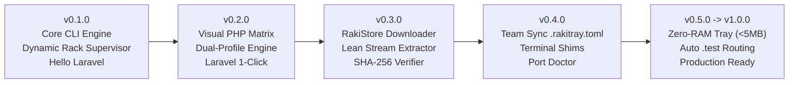

# Rakitray Engineering Roadmap

This document defines Rakitray's Semantic Versioning policy, release lifecycle criteria, and feature milestone roadmap from `v0.1.0` through `v1.0.0`, with an uncompromising **Laravel-First** focus.

---

## 1. Versioning Principles & SemVer Policy

Rakitray follows [Semantic Versioning 2.0.0](https://semver.org/) (`MAJOR.MINOR.PATCH`). Because Rakitray serves both as a native GUI application and as a developer CLI toolchain, version increments carry explicit system guarantees:

```
vMAJOR.MINOR.PATCH
 │     │     └── Bug fixes, security patches, upstream runtime catalog hash updates (backward-compatible)
 │     └──────── New features, new service drivers, CLI commands, UI views, schema extensions (backward-compatible)
 └────────────── Breaking configuration changes, runtime directory layout breaking shifts, minimum OS requirement bumps
```

### 1.1 Pre-1.0.0 Policy (`v0.Y.Z`)
- **`v0.MINOR.0`**: Introduces major feature milestones, architectural components, or service integrations. Backward compatibility of internal Rust APIs may shift between minor versions before `v1.0.0`, but user `.rakitray.toml` configuration schemas MUST maintain forward-migration paths.
- **`v0.MINOR.PATCH`**: Bug fixes, stability patches, upstream engine download link updates, and OS compatibility updates.
- **Breaking Changes**: Any breaking change to `.rakitray.toml` or CLI arguments will be signaled with a deprecation warning before deprecation.

### 1.2 Stable Policy (`v1.0.0+`)
- **`MAJOR`**: Modifications to the `.rakitray.toml` core spec that cannot be automatically migrated, deletion of public `rakit` CLI commands, or breaking changes to `rakitray-core` public crate APIs.
- **`MINOR`**: Additions of runtime engines (e.g., PostgreSQL, Apache, Meilisearch), new CLI subcommands, new visual dashboard modules, or backward-compatible schema options.
- **`PATCH`**: Performance optimizations, security updates, lean extraction rule refinements, and bug fixes.

---

## 2. Laravel-First Philosophy & Milestones Overview

Laravel is the primary benchmark for Rakitray's developer experience. A modern Laravel development environment requires:
- High-performance **Nginx** webserver with optimized `fastcgi_pass` routing.
- Multi-version **PHP-FPM / PHP-CGI** with instantaneous switching (e.g. PHP 8.1 for legacy projects, PHP 8.2/8.3/8.4 for modern apps).
- Fully featured PHP extensions enabled out-of-the-box (`pdo_mysql`, `mbstring`, `openssl`, `curl`, `fileinfo`, `bcmath`, `tokenizer`, `xml`, `zip`).
- Low-latency **MariaDB** or **MySQL** instance.
- Optional **Redis** for queue workers, cache, and session management.
- Zero-hassle CLI shims for `php`, `composer`, `artisan`, and `bun`.



---

## 3. Detailed Version Milestones

### `v0.1.0` — Core CLI Engine, Dynamic Rack Supervisor & Hello Laravel
> **Theme:** Establish the rock-solid Rust process supervisor, dynamic runtime discovery filesystem layout, baseline CLI, and dynamic SolidJS rack UI.

- [ ] **Dynamic Runtime Discovery Hierarchy**:
  - Automatically index runtimes installed inside the local portable structure:
    ```
    runtime/bin/<category>/<engine>/<version>/
    ├── php/php-cgi/8.3.12/
    ├── nginx/nginx/1.26.2/
    └── mariadb/mariadb/11.4.3/
    ```
  - Zero hardcoded version assumptions; discover installed versions purely through directory traversal and binary execution checks (`--version`).
- [ ] **Anti-Zombie Process Supervision**:
  - **Linux / macOS**: Spawn child services in isolated Process Groups (`setpgid(0, 0)`). Configure Linux child processes with `prctl(PR_SET_PDEATHSIG, SIGTERM)` so child processes terminate if the parent process dies. Escalates stopping from `SIGTERM` to `SIGKILL` after a 5-second graceful timeout.
  - **Windows**: Assign all spawned child processes to a Win32 Job Object configured with `JOB_OBJECT_LIMIT_KILL_ON_JOB_CLOSE`. Guarantees zero orphaned processes on crash, reboot, or unexpected exit.
- [ ] **Nginx + Multi-PHP-FPM + MariaDB Core Drivers**:
  - Dynamic generation of `nginx.conf`, upstream `fastcgi_pass` sockets/ports, and `php-cgi.exe` / `php-fpm` worker pooling.
  - MariaDB automated data directory initialization (`mysql_install_db` / `--initialize-insecure`).
- [ ] **`rakit` Core CLI**:
  - `rakit up`: Boots up the rack stack or project environment.
  - `rakit down`: Gracefully halts running service groups.
  - `rakit status`: Real-time terminal dashboard of running instances, PIDs, uptime, and ports.
- [ ] **SolidJS Dynamic Rack UI & Live Log Channel**:
  - Reactive dashboard rendering runtime cards with fine-grained signals (`createSignal`, `createStore`).
  - High-frequency process output streamed over `tauri::ipc::Channel` with 16ms micro-batching to eliminate UI jank.

---

### `v0.2.0` — Visual PHP Matrix & Dual-Profile Engine
> **Theme:** Eliminate manual `php.ini` editing. Deliver effortless configuration for Laravel developers.

- [ ] **Dynamic Extension Scanner**:
  - Scans `runtime/bin/php/<engine>/<version>/ext/` for available shared libraries (`.dll` on Windows, `.so` on Linux/macOS).
  - Extracts metadata and compatibility flags for each discovered extension.
- [ ] **Visual Checkbox UI**:
  - Interactive grid displaying all discovered extensions categorized by function (Database, String, Security, Performance, Debugging).
  - Real-time toggling with zero manual text file editing; writes back cleanly to isolated configuration layers.
- [ ] **1-Click "Laravel Preset"**:
  - Instant preset button enabling all required extensions for modern Laravel:
    `pdo_mysql`, `mbstring`, `openssl`, `curl`, `fileinfo`, `bcmath`, `tokenizer`, `xml`, `zip`, `ctype`, `json`.
  - Optional toggle for common extras: `redis`, `gd`, `intl`, `pcov`, `xdebug`.
- [ ] **Dual-Profile Engine (`dev` vs `prod`)**:
  - **`dev` Profile**: `display_errors = On`, `display_startup_errors = On`, `error_reporting = E_ALL`, `opcache.revalidate_freq = 0`, Xdebug enabled on port 9003.
  - **`prod` Profile**: `display_errors = Off`, `log_errors = On`, `opcache.validate_timestamps = 0`, maximum memory and upload limits optimized for benchmark testing.
- [ ] **Profile Inheritance Across PHP Versions**:
  - Apply configured extension sets and ini profiles across multiple installed PHP versions (e.g. clone PHP 8.2 profile to PHP 8.3) with a single click.

---

### `v0.3.0` — RakiStore Downloader & Lean Extractor
> **Theme:** Ultra-fast, bloatware-free runtime acquisition with cryptographic safety.

- [ ] **Multi-Threaded Downloader**:
  - Concurrent chunked HTTP range downloading with automatic retry, exponential backoff, and progress feedback through Tauri `Channel`.
- [ ] **Cryptographic Verification**:
  - Enforce SHA-256 checksum verification against official upstream manifests before extracting any downloaded archive.
- [ ] **Lean Streaming Extractor**:
  - Stream-filter archives during decompression to disk, stripping unused bloat:
    - Debug symbols and import libraries: `**/*.pdb`, `**/*.lib`, `**/*.exp`.
    - Unnecessary test suites and benchmarks: `mysql-test/**`, `sql-bench/**`.
    - Static manuals and documentation: `doc/**`, `docs/**`, `manual/**`.
  - Reduces disk usage by up to 60% compared to standard zip extractions.
- [ ] **Security Validation (Anti-Zip Slip)**:
  - Canonical path resolution ensuring no archive entry can write outside its designated sandbox target directory (`..` traversal defense).

---

### `v0.4.0` — Team Sync `.rakitray.toml`, Terminal Shims & Port Doctor
> **Theme:** Team environment parity, frictionless terminal development, and automated networking problem resolution.

- [ ] **Team Sync Manifest (`.rakitray.toml` & `rakitray.lock`)**:
  - Commit environment specifications directly into git repositories.
  - `rakit sync` command parses the file and prepares the required PHP version, extensions, and webserver configurations.
- [ ] **Terminal Shims & Dynamic PATH Management**:
  - Lightweight executable shims (`rakit-shim`) placed in user PATH for `php`, `composer`, `artisan`, and `bun`.
  - Shim dynamically routes commands to the project's active runtime version specified in `.rakitray.toml`.
- [ ] **1-Click Port Conflict Doctor**:
  - Native socket table inspection mapping conflicting TCP ports (e.g. 80, 443, 3306, 6379, 8000) directly to conflicting PIDs and process names.
  - 1-click action to terminate rogue processes or automatically reassign to next available incremented port with configuration updates.

---

### `v0.5.0` -> `v1.0.0` — Zero-RAM Tray & Auto `.test` Routing
> **Theme:** Minimal system footprint, zero idle overhead, and production-grade stability.

- [ ] **Zero-RAM Tray Lifecycle Manager**:
  - Intercept window close events: immediately destroy the WebView window (`window.destroy()`), releasing 100% of WebView RAM footprint.
  - Background Tokio supervision remains active in the system tray at `<5MB` total RAM.
  - Sub-second WebView recreation upon tray icon click or shortcut invocation.
- [ ] **Automatic Local `.test` Domain Routing**:
  - Embedded local DNS responder or automated `/etc/hosts` / Windows `hosts` manager.
  - Automatic routing of `<project>.test` to `127.0.0.1`.
- [ ] **Automated Local TLS / HTTPS**:
  - Built-in local CA generator and system trust-store installer (`mkcert`-compatible architecture) providing valid SSL certificates for local domains without browser warnings.
- [ ] **`v1.0.0` Production Readiness**:
  - Complete test coverage across Windows (Win11/Win10), Linux (Ubuntu, Fedora, Arch), and macOS (Apple Silicon / Intel).
  - Stable CLI and `.rakitray.toml` v1 schema freeze.
  - Full documentation, telemetry-free distribution, and community recipe catalog.

---

## 4. Delivery Tracker & Acceptance Criteria

| Version | Milestone | Primary Deliverable | Acceptance Criteria |
| :--- | :--- | :--- | :--- |
| **`v0.1.0`** | Dynamic Rack & Core CLI | Core process supervisor & dynamic discovery | Clean boot of Nginx + PHP-FPM + MariaDB; `rakit up/down/status`; Anti-Zombie termination on all OS. |
| **`v0.2.0`** | PHP Matrix & Profiles | Checkbox PHP extension UI & Laravel preset | Toggle extensions without opening text editor; 1-click Laravel presets; dual dev/prod ini generation. |
| **`v0.3.0`** | RakiStore Downloader | Parallel downloader & lean extractor | SHA-256 verified downloads; automated stripping of `.pdb` and `mysql-test`; Zip-Slip immune. |
| **`v0.4.0`** | Team Sync & Port Doctor | `.rakitray.toml` & Terminal Shims | Team sync via `rakit sync`; transparent terminal `php` / `composer` shims; smart port conflict resolution. |
| **`v0.5.0`** | Zero-RAM Tray | WebView destroy/recreate | UI memory drops to `<5MB` when minimized to tray; background services remain running without interruption. |
| **`v1.0.0`** | Local `.test` & GA Release | Automated local domains & TLS | Native `<project>.test` HTTPS resolution; fully hardened CLI + GUI; stable API guarantees. |

