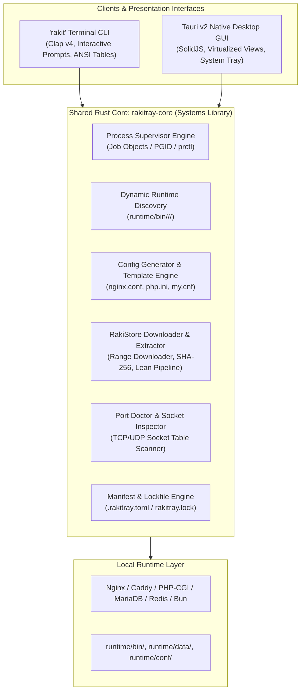

# Rakitray Team Specification & CLI Reference (`TEAM_CLI_SPEC.md`)

This document defines the **CLI-First Architecture** of Rakitray, the command-line interface specification for the **`rakit`** binary, and the complete schema for the git-committable **`.rakitray.toml`** team project manifest.

---

## 1. CLI-First Architecture

Rakitray is designed from the ground up as a **CLI-first, headless-capable development environment orchestrator**. The desktop GUI is not the foundation of Rakitray; rather, both the **`rakit` CLI** and the **Tauri v2 Desktop GUI** are parallel presentation clients interacting with a shared, pure-Rust systems core crate: `rakitray-core`.



### Key Architectural Tenets
1. **Zero Logic Duplication**: Process spawning, configuration templating, socket detection, and archive extraction logic live entirely inside `rakitray-core`. Neither the CLI nor the GUI implements proprietary process supervision rules.
2. **Headless & CI/CD Ready**: The `rakit` CLI operates identically on headless remote servers, Docker environments, and local workstations without requiring an X11/Wayland display server or webview runtime.
3. **Atomic State Synchronization**: Changes initiated via the CLI (such as enabling an extension with `rakit php ext enable pdo_mysql`) immediately affect the state rendered by the GUI, and vice versa.

---

## 2. `rakit` CLI Command Reference

The `rakit` command-line tool provides full control over local development stacks and project-level environments.

### 2.1 Global Flags & Options
All `rakit` commands support the following global options:
- `-v, --verbose`: Enable verbose debug logging output.
- `-q, --quiet`: Suppress non-essential output and progress bars.
- `--json`: Format command output as machine-readable JSON (ideal for script integration).
- `-c, --config <PATH>`: Override path to `.rakitray.toml` (defaults to `./.rakitray.toml`).
- `-h, --help`: Display command-line help.
- `-V, --version`: Print Rakitray version and attribution information.

---

### 2.2 Core Commands

#### `rakit init`
Initializes a new `.rakitray.toml` configuration in the current working directory.

```bash
rakit init [OPTIONS]
```

**Options:**
- `--name <NAME>`: Project name (defaults to current directory name).
- `--php <VERSION>`: Specify PHP version (e.g., `8.3`, `8.2`).
- `--web <ENGINE>`: Webserver engine: `nginx` (default) or `caddy`.
- `--db <ENGINE>`: Database engine: `mariadb` (default), `mysql`, or `none`.
- `--preset <PRESET>`: Pre-configure extension bundle (`laravel`, `wordpress`, `symfony`, `minimal`). Defaults to `laravel`.
- `-y, --yes`: Accept defaults without interactive prompts.

**Behavior:**
- Detects existing framework indicators in the directory (e.g. `artisan` triggers the Laravel preset by default).
- Generates a formatted, commented `.rakitray.toml` manifest in the project root.

---

#### `rakit up`
Starts the service stack defined by the current project's `.rakitray.toml` (or boots the global rack if invoked outside a project).

```bash
rakit up [OPTIONS] [SERVICES]...
```

**Options:**
- `-d, --detach`: Run processes in the background (supervisor keeps running; returns shell prompt).
- `--build`: Force regeneration of local configuration files (`nginx.conf`, `php.ini`, etc.) before booting.
- `--no-sync`: Do not attempt to automatically download missing runtimes before startup.

**Example:**
```bash
rakit up
# Or start only specific services
rakit up php nginx
```

---

#### `rakit down`
Gracefully stops running services for the active project or the global rack.

```bash
rakit down [OPTIONS]
```

**Options:**
- `--timeout <SECONDS>`: Maximum grace period before escalating to force-kill (default: 5 seconds).
- `-f, --force`: Immediately issue `SIGKILL` / Job Object termination without waiting for graceful shutdown.

---

#### `rakit restart`
Equivalent to executing `rakit down` followed immediately by `rakit up`.

```bash
rakit restart [OPTIONS] [SERVICES]...
```

---

#### `rakit status`
Displays the real-time operational status, process IDs, memory usage, and open ports for all services in the current stack.

```bash
rakit status [OPTIONS]
```

**Sample Output:**
```
+----------+---------+---------+-------+---------+----------+------------+
| SERVICE  | ENGINE  | VERSION | STATE | PID     | PORTS    | MEMORY RSS |
+----------+---------+---------+-------+---------+----------+------------+
| web      | nginx   | 1.26.2  | UP    | 48120   | 80, 443  | 14.2 MB    |
| php      | php-cgi | 8.3.12  | UP    | 48135   | 9000     | 38.6 MB    |
| database | mariadb | 11.4.3  | UP    | 48149   | 3306     | 64.1 MB    |
| cache    | redis   | 7.2.5   | UP    | 48160   | 6379     | 9.8 MB     |
+----------+---------+---------+-------+---------+----------+------------+
Project: my-laravel-app | Domain: https://my-laravel-app.test | Uptime: 2h 14m
```

When passed `--json`, outputs raw machine-readable telemetry.

---

#### `rakit php ext`
Manages PHP dynamic extensions directly from the terminal. Changes immediately synchronize with the GUI and project configuration.

```bash
rakit php ext <SUBCOMMAND>
```

**Subcommands:**
- `list`: Lists all discovered extensions in `runtime/bin/php/<version>/ext/` along with their active enabled/disabled status.
  ```bash
  rakit php ext list
  ```
- `enable <EXTENSION>`: Enables one or more extensions in the active PHP profile.
  ```bash
  rakit php ext enable redis xdebug
  ```
- `disable <EXTENSION>`: Disables one or more extensions in the active PHP profile.
  ```bash
  rakit php ext disable xdebug
  ```

---

#### `rakit sync`
Synchronizes the local system state with `.rakitray.toml`. Reads the manifest, checks for installed runtimes in `runtime/bin/`, and automatically downloads and lean-extracts any missing engine versions or extensions.

```bash
rakit sync [OPTIONS]
```

**Options:**
- `--check`: Validate dependencies without downloading; exits with code `1` if dependencies are missing.
- `--force`: Force redownload and verification of all specified runtimes.

---

## 3. `.rakitray.toml` Schema Specification

The `.rakitray.toml` file is located at the root of a project repository. It is human-readable, deterministic, and intended to be checked into version control (git) so all team members run an identical environment.

### 3.1 Annotated Example (`.rakitray.toml` for Laravel 11)

```toml
# Rakitray Project Configuration
schema_version = 1
name = "my-laravel-app"
domain = "my-laravel-app.test"

[web]
engine = "nginx"
version = "1.26.2"
root = "public"
index = "index.php"
https = true

[php]
engine = "php-cgi"
version = "8.3.12"
profile = "dev"

# Extensions required for this project
extensions = [
  "bcmath",
  "curl",
  "fileinfo",
  "mbstring",
  "openssl",
  "pdo_mysql",
  "redis",
  "tokenizer",
  "xml",
  "zip"
]

[php.ini_overrides]
memory_limit = "512M"
upload_max_filesize = "64M"
post_max_size = "64M"
max_execution_time = 120

[services.mariadb]
enabled = true
version = "11.4.3"
database = "my_laravel_app"
port = 3306

[services.redis]
enabled = true
version = "7.2.5"
port = 6379
```

---

### 3.2 Schema Field Reference

| Key | Type | Default | Description |
| :--- | :--- | :--- | :--- |
| `schema_version` | integer | `1` | Schema version number for forward/backward compatibility migrations. |
| `name` | string | *Directory name* | Identifier name for the project instance. |
| `domain` | string | `<name>.test` | Local domain routed to this project's web root. |
| `web.engine` | string | `"nginx"` | Webserver engine to route requests (`nginx` or `caddy`). |
| `web.version` | string | `"latest"` | SemVer or explicit version of the webserver runtime. |
| `web.root` | string | `"public"` | Web document root relative to project root (e.g. `"public"` for Laravel). |
| `web.index` | string | `"index.php"` | Primary directory index file. |
| `web.https` | boolean | `true` | Whether to generate and bind local SSL/TLS certificates. |
| `php.engine` | string | `"php-cgi"` | PHP execution driver (`php-cgi` or `php-fpm`). |
| `php.version` | string | `"8.3"` | PHP version required by the application. |
| `php.profile` | string | `"dev"` | Active environment configuration profile (`dev` or `prod`). |
| `php.extensions` | array of strings | `[]` | List of dynamic extension modules required to be loaded. |
| `php.ini_overrides` | table | `{}` | Key-value pairs overriding standard `php.ini` directives. |
| `services.<name>` | table | `{}` | Declarative configuration for additional services (`mariadb`, `mysql`, `redis`, `mailpit`). |
| `services.<name>.enabled` | boolean | `true` | Toggle service on or off for this project. |
| `services.<name>.version` | string | `"latest"` | Specific version of the service engine. |
| `services.<name>.port` | integer | *Engine default* | Port binding for the service. |

---

### 3.3 Companion Lockfile (`rakitray.lock`)

When running `rakit sync` or `rakit up`, Rakitray writes a `rakitray.lock` file adjacent to `.rakitray.toml`. This lockfile pins:
- Exact upstream download URLs.
- Cryptographic SHA-256 archive checksums.
- Exact extracted binary patch versions.

This ensures 100% byte-for-byte reproducibility across all team members and CI machines.

